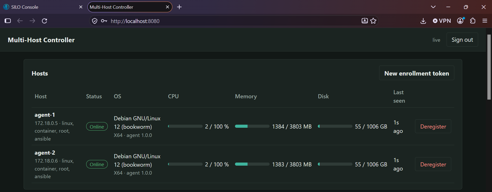
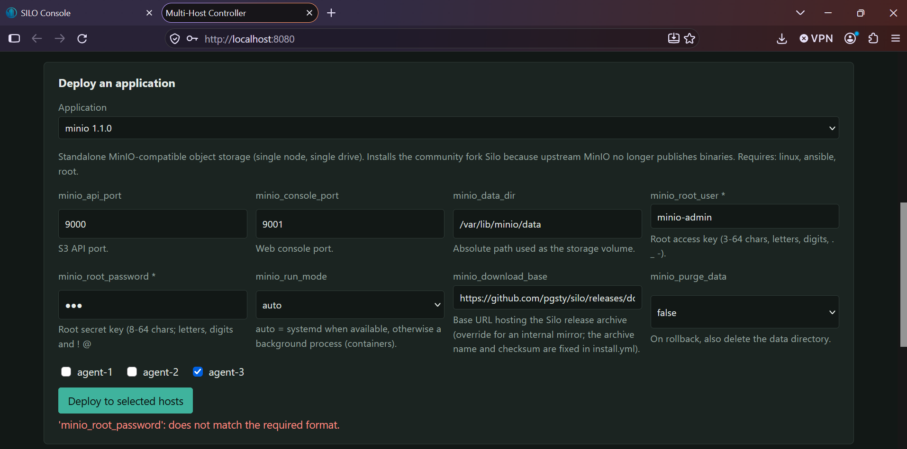
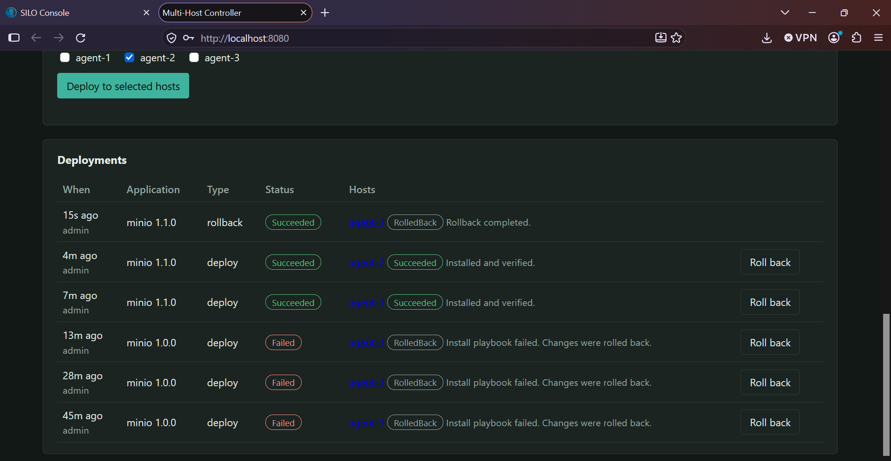
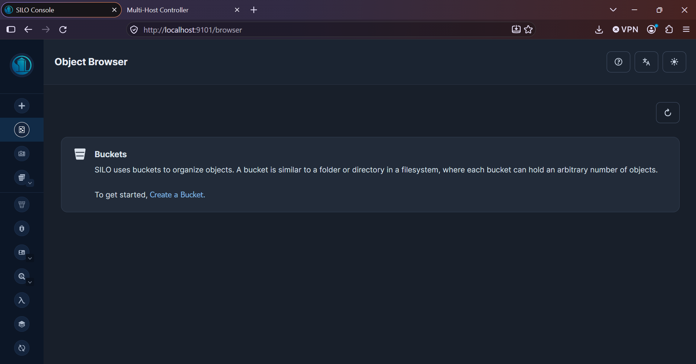
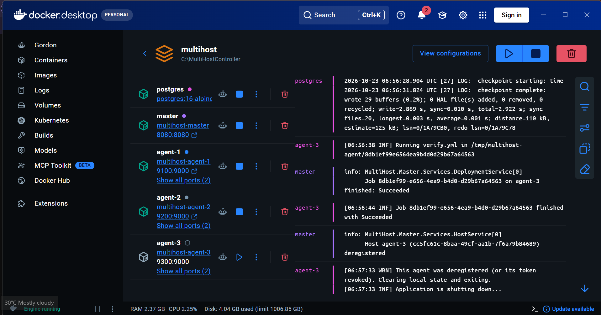
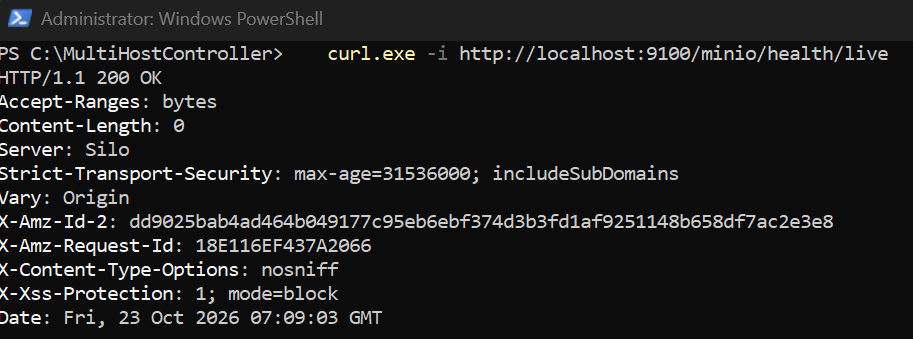
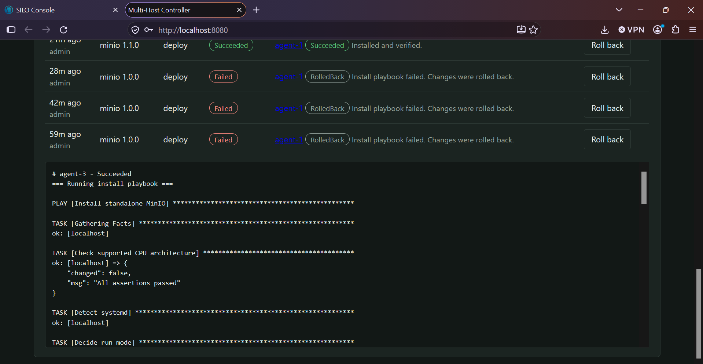
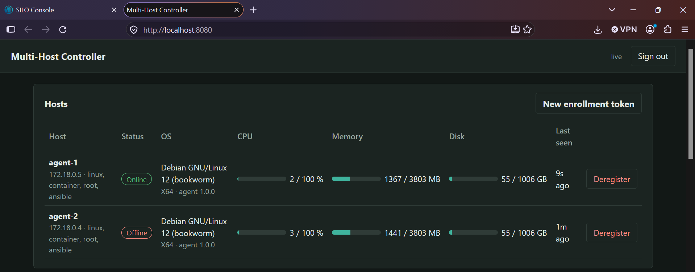
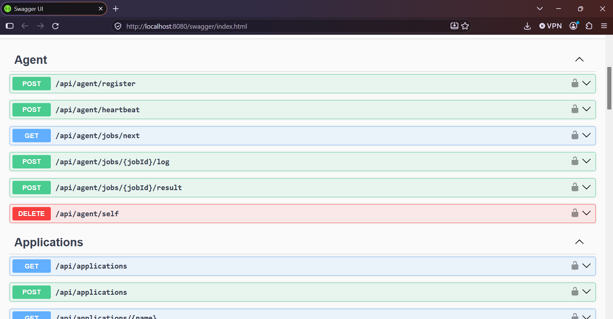

# Multi-Host Controller

A master/agent system in .NET 8 that registers hosts, monitors their health and deploys applications (MinIO included) with Ansible playbooks.

* **Master** (`src/MultiHost.Master`): ASP.NET Core Web API + SignalR + web dashboard, EF Core / PostgreSQL.
* **Agent** (`src/MultiHost.Agent`): .NET Worker Service (Linux systemd / Windows Service / container). Registers, sends heartbeats and runs `ansible-playbook` locally.
* **Shared** (`src/MultiHost.Shared`): wire contracts.
* **Playbooks** (`playbooks/`): application packages. `minio/` is ready to use; `_template/` is the skeleton for new apps.
* **Tests** (`tests/`): xUnit unit + integration tests (in-memory DB).

See [docs/ARCHITECTURE.md](docs/ARCHITECTURE.md) for the diagram and design decisions and [docs/API.md](docs/API.md) for the API.

> **Status:** the master and agent build in Docker, register and exchange heartbeats. The MinIO(Silo) playbooks were run end-to-end (install, verify, idempotent re-run, rollback) with real Ansible. See "Known gaps" below.

## Quick start (Docker Compose)

Requirements: Docker with Compose v2 and outbound internet access (agents download the server archive from GitHub).

```bash
cp .env.example .env        # optional but recommended: set real secrets
docker compose up --build
```

| What | Where |
|---|---|
| Dashboard | http://localhost:8080 (login `admin` / `ADMIN_PASSWORD`, default `admin-change-me`) |
| Swagger | http://localhost:8080/swagger |
| MinIO on agent-1/2/3 (after deploying) | API `localhost:9100/9200/9300`, console `localhost:9101/9201/9301` |

The stack runs PostgreSQL, the master and three agents (`agent-1..3`) that auto-register. Containers have no systemd, so the playbook starts MinIO as a background process (`minio_run_mode: auto`); on real hosts with systemd it installs a service unit.

### Deploy MinIO
1. Open the dashboard. Three hosts should be **Online** with capabilities `linux, container, root, ansible`.
2. Under *Deploy an application* choose `minio`, set the root password (8-64 chars), tick hosts, click **Deploy**.
3. Watch status and click a host name to stream its Ansible log. The agent runs install, then `verify.yml` (health endpoints). If either fails, `rollback.yml` runs automatically (`RolledBack`).
4. Check `curl -i localhost:9100/minio/health/live`, or run `scripts/demo.sh` for the same flow via the API.
5. **Roll back** removes MinIO again (data is kept unless `minio_purge_data=true`).

## Evidence (screenshots from a live run)

| What it shows | Screenshot |
|---|---|
| **Registration and monitoring.** Agents self-registered, report OS, architecture, capabilities (`linux, container, root, ansible`) and live CPU / memory / disk. |  |
| **Configuration management and input validation.** Per-application variable form (ports, data path, credentials, run mode); an invalid password is rejected by the master with a clear message. |  |
| **Deployment history, automatic rollback and manual rollback.** The three `minio 1.0.0` rows failed on the removed upstream download and were rolled back automatically; `minio 1.1.0` succeeded ("Installed and verified") on `agent-1` and `agent-2`; the top row is a manual rollback. |  |
| **End-to-end result.** The deployed server's console (Silo, the MinIO-compatible fork) reachable on the mapped port. |  |
| **Deregistration and clean-up.** The master logs the deregistration; the agent notices its token was revoked, clears local state and exits. Its job had just succeeded with `verify.yml`. |  |
| **Health check.** `curl` against the deployed server returns `200 OK` (`Server: Silo`). |  |
| **Playbook execution and live logging.** Ansible output streamed from the agent into the dashboard while the job runs. |  |
| **Availability detection.** `agent-2` was stopped; after the heartbeat timeout the master marks it **Offline** (last seen 1m ago) while `agent-1` stays Online. |  |
| **API documentation.** Swagger UI listing the agent, application, host and deployment endpoints. |  |

## Running without Docker
```bash
# PostgreSQL must be reachable; adjust ConnectionStrings:Default
export Security__JwtKey="$(openssl rand -base64 48)"
export Admin__Password='a-strong-password'
export Playbooks__Directory=$PWD/playbooks
dotnet run --project src/MultiHost.Master          # prints the listening URL

# On a managed Linux host (root, ansible-core installed):
export Agent__MasterUrl=https://master.example.com Agent__EnrollmentToken=<token from dashboard>
dotnet run --project src/MultiHost.Agent
```
Get an enrollment token with the dashboard's **New enrollment token** button or `POST /api/enrollment-tokens`.

### Installing the agent as a service
* **Linux**: `dotnet publish src/MultiHost.Agent -c Release -r linux-x64 --self-contained -o /opt/multihost-agent`, then use `deploy/multihost-agent.service` (edit URL/token) and `systemctl enable --now multihost-agent`.
* **Windows**: `dotnet publish -r win-x64 --self-contained -o C:\multihost-agent`, then `sc.exe create MultiHostAgent binPath= "C:\multihost-agent\MultiHost.Agent.exe" start= auto` (set the `Agent__*` settings in `appsettings.json`). The agent reports CPU/memory/disk and heartbeats on Windows; Ansible does not run natively on Windows, so Linux-only packages (like `minio`) correctly refuse to deploy there because the host lacks the `linux`/`ansible` capabilities.

## Configuration
Master (`appsettings.json` / env vars like `Security__JwtKey`): `Security:JwtKey` (>= 32 chars, **required**), `Security:BootstrapEnrollmentToken`, `Admin:Username/Password` (a random password is logged once if empty), `Monitoring:*` (heartbeat interval, offline threshold, job timeout, retention), `Playbooks:Directory`, `Swagger:Enabled`.
Agent (`Agent__*`): `MasterUrl`, `EnrollmentToken`, `StateFile`, `LogDirectory` (rolling file logs), `AllowInsecureHttp`, `AllowInvalidCertificate`, `AnsiblePlaybookPath`, `JobTimeoutMinutes`.

## Adding a new application
Copy `playbooks/_template` to `playbooks/<name>/`, edit `manifest.yml` (variables, prerequisites, dependencies) and the playbooks, then restart the master or call `POST /api/applications/reload`. Playbook rules: variables arrive as strings (cast with `| int` / `| bool`), use `no_log: true` around secrets, and make `rollback.yml` safe after a partial install. Packages can also be uploaded via `POST /api/applications`.

## Tests and CI
```bash
dotnet test
```
Unit tests cover variable validation and crypto. Integration tests cover authentication, role separation, one-time enrollment, heartbeat, deregistration/token revocation, prerequisite and variable checks, and the full job lifecycle with secret masking. `.github/workflows/ci.yml` builds, tests, syntax-checks the playbooks and builds both images.

## Scope and known gaps
* **mTLS** is not implemented; transport security relies on HTTPS plus JWTs (agent tokens are revocable by deregistration). Adding client-certificate auth to the agent endpoints is the natural next step.
* Deployment variables, including secrets, are stored **unencrypted in PostgreSQL** (masked in API/logs). Use DataProtection/KMS encryption before production.
* Playbooks are delivered unsigned; agents trust the master. Add signature verification for stricter environments.
* Schema is created with `EnsureCreated`; switch to EF Core migrations for upgrades.
* Single-master job hand-out (see ARCHITECTURE.md for the scale-out path). No RabbitMQ/gRPC (deliberately out of scope).
* If an agent dies mid-job, the master marks the job `Failed` after `Monitoring:JobTimeoutMinutes` and does not auto-rollback; run a rollback manually.
* **MinIO binaries are no longer published** (`dl.min.io` returns HTTP 410 and the upstream repository is archived). The `minio` package therefore installs **Silo**, a community fork that is drop-in compatible (same S3/admin API, `MINIO_*` variables and `/minio/health/*` endpoints), pinned to release `2026-08-06` with a SHA-256 check. Change `silo_version`/`silo_sha256` in `install.yml` to upgrade, or point `minio_download_base` at an internal mirror. Standalone only, no TLS on the server itself, root credentials only.

## Troubleshooting
* Agent shows no `ansible` capability: `ansible-playbook` is not on PATH (the compose image installs `ansible-core`).
* Deployment rejected with 422: host offline or missing capabilities; the message lists them.
* Agent exits with "deregistered": expected after removing the host; delete its state volume/file and supply a new enrollment token to re-enroll.
* Master fails at startup with a JwtKey error: set `Security__JwtKey` to 32+ characters.
