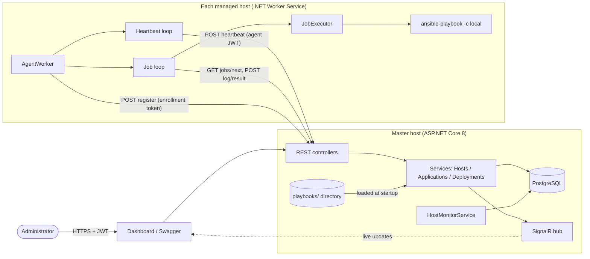

# Architecture

## Key decisions

| Decision | Rationale |
|---|---|
| Agents initiate all traffic (register, heartbeat, poll for jobs, post results) | Works through NAT/firewalls, master needs no inbound access to hosts, no SSH credentials stored on the master. |
| Polling job queue in the DB instead of RabbitMQ/gRPC | Fewer moving parts for the time budget; the `IDeploymentService` seam lets a broker replace polling later. |
| Playbooks execute on the agent via `ansible-playbook -c local` | Matches the "agents execute locally" clarification; no SSH. |
| Variables validated against a per-package schema, passed as a JSON vars file | Prevents injection: nothing user-supplied is ever interpolated into a command line or shell. |
| Per-job state machine: `Pending -> Dispatched -> Running -> Succeeded / Failed / RolledBack / RollbackFailed` | Makes deployment history and failure analysis explicit. |
| Rollback = package-provided `rollback.yml`, run automatically after a failed install/verify and on demand | Keeps rollback logic with the application, not hardcoded in the engine. |

## Security model

* **Admin API**: JWT (HS256, role `Admin`, 60 min). Passwords stored as PBKDF2-SHA256 (150k iterations, salted). Login and registration endpoints are rate limited.
* **Agent enrollment**: a one-time enrollment token (created by an admin, SHA-256 hashed at rest, expires, single use). A reusable bootstrap token can be configured for demos.
* **Agent API**: per-host JWT (role `Agent`, claim `hostId`). On every request the master verifies the host still exists, so deregistering a host revokes its token immediately.
* **Transport**: agents refuse plain HTTP unless `Agent:AllowInsecureHttp=true`. Terminate TLS at Kestrel or a reverse proxy. mTLS is a documented next step (see README).
* **Input validation**: DataAnnotations on every DTO, strict schema validation for deployment variables, YAML syntax validation for uploaded playbooks, size limits.
* **Secrets**: variables marked `secret` are masked in API responses and redacted from streamed logs; playbooks must use `no_log: true`. The agent writes the vars file with mode 0600 and deletes the working directory afterwards.
* **Headers**: CSP, `X-Content-Type-Options`, `X-Frame-Options`, `Referrer-Policy`.

## Data model

`ManagedHost` 1-* `MetricSample` (cascade) · `ApplicationPackage` 1-* `Deployment` 1-* `DeploymentJob` (job -> host is nullable: history survives host removal) · `EnrollmentToken` · `AdminUser`.

## Scalability notes

* The master is stateless apart from the DB and SignalR; it can be scaled out behind a load balancer if (a) SignalR uses a backplane and (b) job hand-out in `DeploymentService.GetNextJobAsync` switches from the in-process semaphore to `SELECT ... FOR UPDATE SKIP LOCKED` (or an `xmin` concurrency token).
* Heartbeat samples are pruned after `Monitoring:MetricRetentionHours`; for large fleets move them to a time-series store and increase the heartbeat interval.
